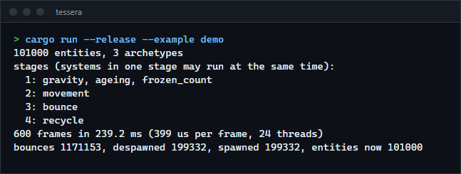
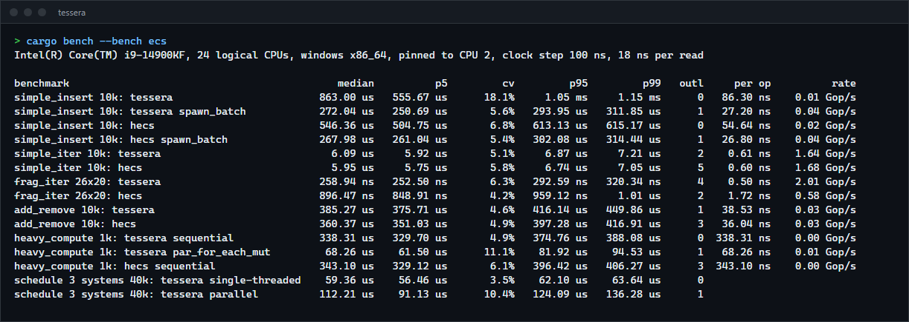

# tessera

An entity component system for Rust: components stored in archetype tables, cached queries with `Added` and `Changed` detection, and systems written as plain functions whose parameters declare what they read and write, so a schedule can run the ones that do not conflict at the same time. For anyone writing a game or simulation who wants to see how an ECS works inside, or needs a small one without a large engine.

**Status:** v0.1.0, working on Windows (the platform-independent code was not run elsewhere). Not published to crates.io.



## Features

- **Archetype storage:** one table per set of component types, one type-erased column per component, so a query walks dense arrays. Moving an entity between tables (insert, remove) uses cached transitions.
- **Entities** with generations: an id that outlives its entity never reaches whatever reuses the slot.
- **Queries:** tuples of `&T`, `&mut T`, `Option<..>` and `Entity`, filtered by `With`, `Without`, `Added` and `Changed`. A query state remembers the matching tables and only checks tables created since.
- **Change detection:** writes through `Mut<T>` (what `&mut T` yields) stamp a tick; reading through it does not. Resources have the same (`Res::is_changed`).
- **Systems** are functions: `fn movement(mut q: Query<(&mut Pos, &Vel)>, dt: Res<Dt>)`. Parameters: `Query`, `Res`, `ResMut`, `Commands` (deferred spawn, despawn, insert, remove), `Local`, and `fn(&mut World)` for exclusive systems.
- **Parallel schedule:** systems run in the order added, but each waits only for earlier systems it conflicts with. Two queries naming the same component do not conflict when one requires a component the other excludes (`With<Player>` against `Without<Player>`). Conflicting parameters inside one system are refused when the system is added.
- **Parallel iteration:** `Query::par_for_each_mut(batch, f)` splits the tables into row ranges on the shared thread pool ([workpool](https://github.com/r3clusionn/thread-pool-library), from this portfolio).

## How to install

Requires a recent stable Rust (built with 1.98.1). Add it from git:

```toml
[dependencies]
tessera = { git = "https://github.com/r3clusionn/ecs-framework" }
```

## How to use

```rust
use tessera::{Commands, Entity, Query, Res, Schedule, With, Without, World};

#[derive(Clone, Copy)] struct Pos(f32, f32);
#[derive(Clone, Copy)] struct Vel(f32, f32);
struct Player;
struct Dt(f32);

fn movement(mut q: Query<(&mut Pos, &Vel)>, dt: Res<Dt>) {
    for (mut p, v) in q.iter_mut() {
        p.0 += v.0 * dt.0;
        p.1 += v.1 * dt.0;
    }
}

fn follow(mut player: Query<&mut Pos, With<Player>>, others: Query<&Pos, Without<Player>>) {
    let target = *others.single();
    for mut p in player.iter_mut() {
        *p = target;
    }
}

fn cleanup(q: Query<(Entity, &Pos)>, mut c: Commands) {
    for (e, p) in q.iter() {
        if p.1 < -100.0 {
            c.despawn(e);
        }
    }
}

let mut world = World::new();
world.insert_resource(Dt(1.0 / 60.0));
world.spawn((Pos(0.0, 0.0), Vel(1.0, 0.0)));
world.spawn((Pos(0.0, 0.0), Player));

let mut schedule = Schedule::new();
schedule.add_system(movement).add_system(follow).add_system(cleanup);
schedule.run(&mut world); // once per frame
```

| Call | What it does |
|---|---|
| `world.spawn((A, B))`, `spawn_batch(iter)` | Create entities (a tuple of up to 12 components). |
| `world.insert(e, (C,))`, `remove::<C>(e)`, `despawn(e)` | Change an entity; `remove` returns the component. |
| `world.get::<T>(e)`, `get_mut::<T>(e)` | One component (`get_mut` gives a `Mut<T>` that records writes). |
| `world.query::<Q>()`, `query_filtered::<Q, F>()` | A query state; `iter(&world)` for read-only queries, `iter_mut(&mut world)`, `get`, `get_mut`. |
| `world.insert_resource(r)`, `resource::<R>()`, `resource_mut::<R>()` | Singletons. |
| `Schedule::new()`, `.single_threaded()`, `add_system(f)`, `run(&mut world)`, `stages(&mut world)` | Systems; `stages` shows which can run together. |

## Results

`cargo bench --bench ecs`, the ecs_bench_suite workloads against [hecs](https://crates.io/crates/hecs) 0.10, timed with [benchlab](https://github.com/r3clusionn/bench-framework) (30 samples, measuring thread pinned to a performance core), Intel Core i9-14900KF, Windows 11, Rust 1.98.1. Three runs agreed within 5% except where noted.

| Workload | tessera | hecs |
|---|---|---|
| Spawn 10,000 entities with 4 components, one by one | 0.77 to 0.86 ms (noisy: cv 18%) | 0.55 ms |
| Spawn the same as a batch | 0.27 ms | 0.27 ms |
| Iterate 10,000 `(&Velocity, &mut Position)` | 6.1 us | 5.9 us |
| Iterate 520 entities spread over 26 archetypes | 0.26 us | 0.89 us |
| Add then remove a component on 10,000 entities | 0.39 ms | 0.36 ms |
| Heavy compute (1,000 entities, 100 matrix steps each), sequential | 0.34 ms | 0.34 ms |
| Same with `par_for_each_mut` on 24 threads | 0.07 ms | (no parallel query) |



A schedule of three small systems over 40,000 entities (about 20 us of work each, two of them independent) took 55 to 59 us single-threaded and 54 to 112 us parallel across runs: at this size waking pool threads costs as much as the work saved. Parallel scheduling pays off for systems that do more work per run.

The first version spawned 3.5 times slower and added/removed 2.9 times slower than hecs: every spawn allocated and sorted the bundle's component ids and hashed them with SipHash. Caching each bundle type's target table and column order, a faster hasher for internal tables and reserving capacity for batches brought batches level and add/remove within 10%.

## Verification

- `cargo test --release` runs 17 unit tests, 11 system tests, a randomized model test and a doc test.
- **Model test:** 20 seeds of 600 random operations (spawn with four bundle shapes, despawn, insert, remove, mutate through queries, use of stale ids) on the world and on a plain `HashMap` model, compared every 7 steps: every entity's components and three queries. One component owns a `String` and counts its drops; after each run the live count must equal the model's, and zero after the world is dropped. Types include a zero-sized one and one aligned to 32 bytes (checked).
- **Miri** (nightly, 2026-10-02): the unit tests, the model test (2 seeds of 200 steps) and 9 of the 11 system tests, including the parallel scheduler and `par_for_each_mut` on real threads, run without undefined behaviour. The two timing tests are left out, and `-Zmiri-ignore-leaks` is needed because the global pool's threads are never joined. Miri found an integer-to-pointer cast for zero-sized columns, now `ptr::without_provenance_mut`.
- **Scheduler:** a test runs three writers of one component and three readers of another, each sleeping 20 ms. No two writers ever overlap (counted with atomics), at least two readers do, and the run takes under 110 ms where serial execution would take 120. Other tests check stage grouping, that commands apply after the run, that a panicking system re-panics after the others finish, and that a single-threaded schedule gives the same result.
- **Change detection:** per-system `Changed` and `Added` across runs, reading without writing is not a change, resource ticks.
- **Mutations:** 16 hand-made mutations (generation reuse, swap-remove, moved-entity locations, tick comparison, `Mut` stamping, archetype caching, access disjointness, schedule dependencies, command application) were each caught except one: disjointness was tested in only one direction. A test for the mirror case now catches it.
- A bug found by the tests: a component inserted right after a query iterated was not seen as `Added`, because the query claimed the next tick for itself. Iterations now claim the current tick and advance past it.

## Limits

- Change ticks are 32-bit and compared with wraparound in mind; a change older than about 2 billion ticks can look new again.
- No relations or hierarchies, no events, no system ordering beyond insertion order, no run conditions.
- `Commands` cannot return the entity they will spawn (ids are not reserved ahead).
- Queries with `With`/`Without` are disjoint for the conflict check, `Option<&mut T>` is not; and the scheduler compares parameters one by one, so a system with two disjoint queries can still be ordered after another system more often than needed.
- The world is `Sync` but systems are the only safe way to touch it from several threads.

## License

MIT (see `LICENSE`).
